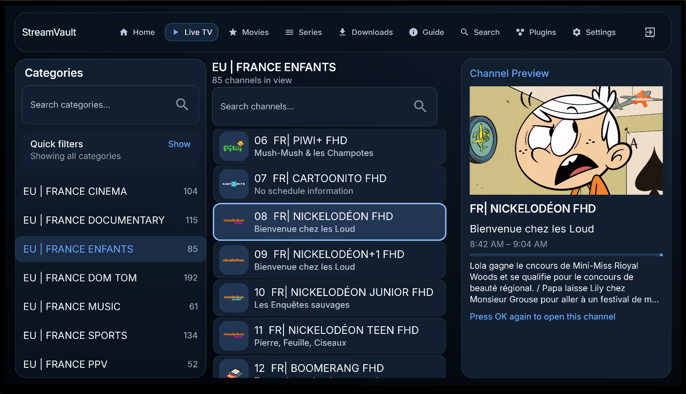
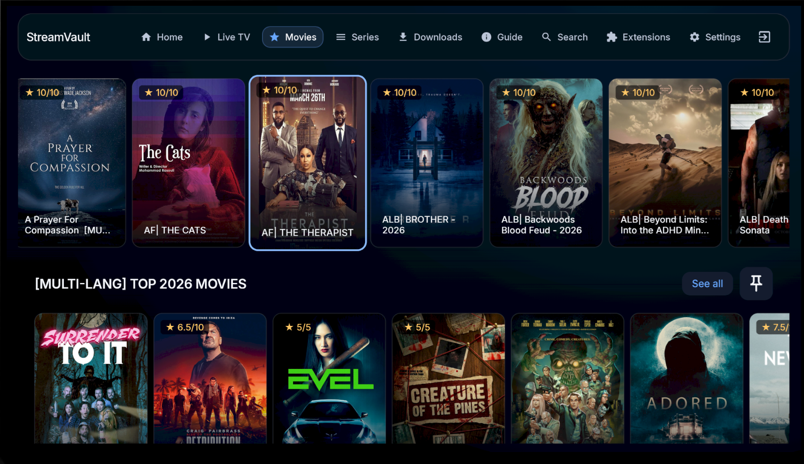
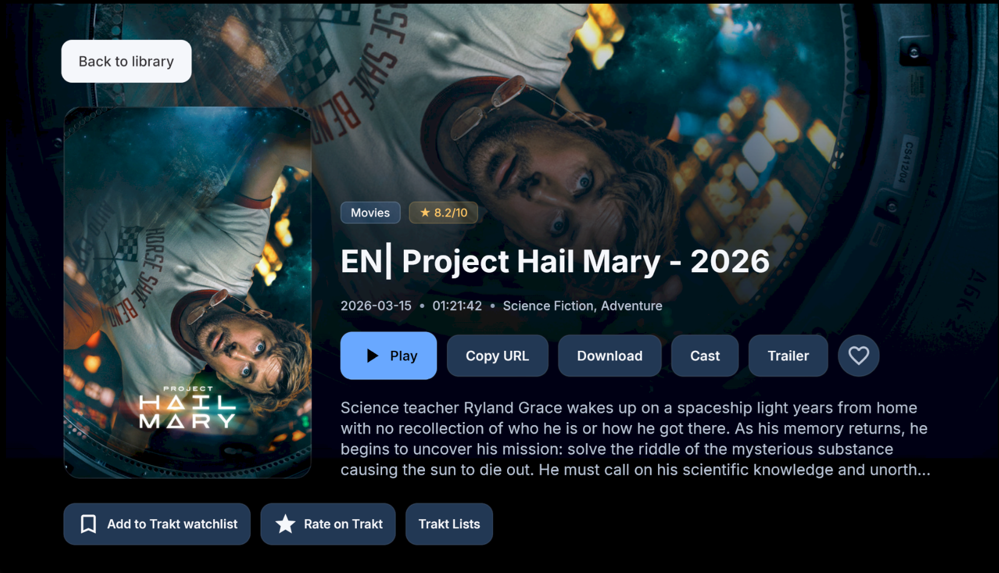
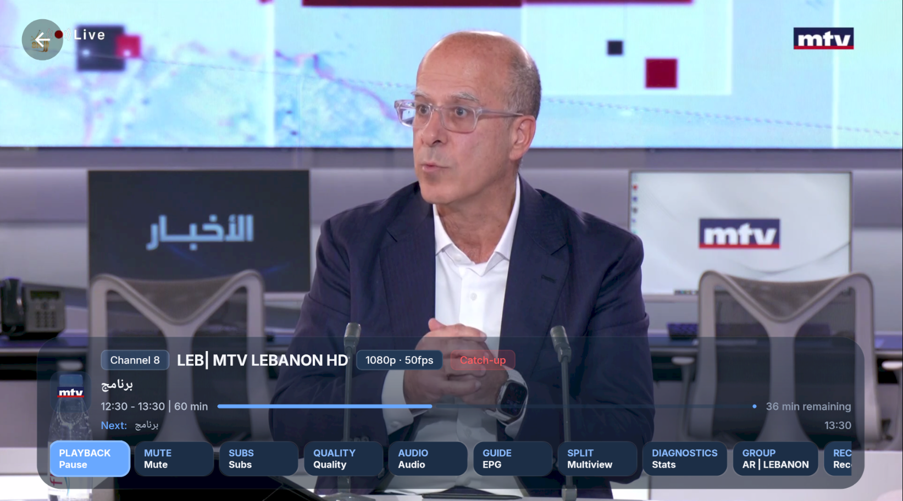
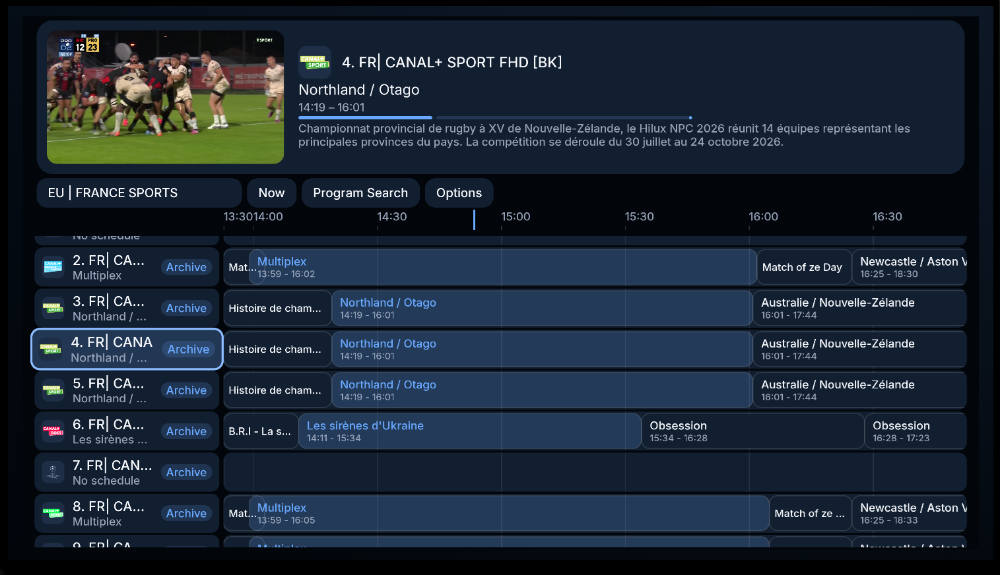
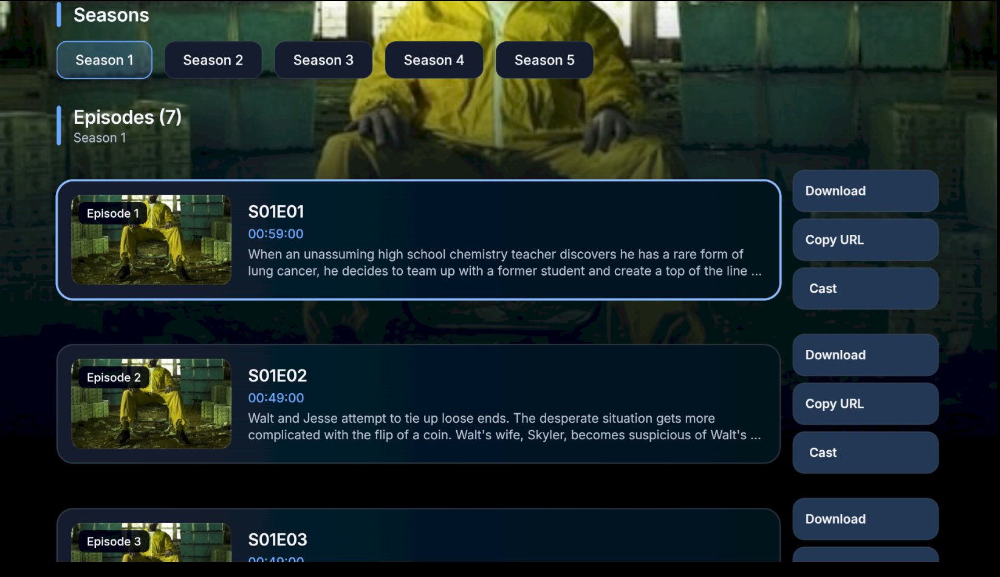

# StreamVault

<p align="center">
	<a href="https://github.com/Davidona/StreamVault-IPTV/releases/latest/download/StreamVault.apk"></a>
	<a href="https://github.com/Davidona/StreamVault-IPTV/releases/latest"></a>
	<a href="https://github.com/Davidona/StreamVault-IPTV/releases"></a>
	<a href="https://discord.gg/FrkumnnTz"></a>
	<a href="docs/CHANGELOG.md"></a>
	<a href="https://github.com/Davidona/StreamVault-IPTV/actions/workflows/release.yml"></a>
	<a href="https://ko-fi.com/davidona"></a>
	<a href="LICENSE"></a>
</p>

StreamVault is a TV-first media player for Android TV built with Kotlin, Jetpack Compose, Room, Hilt, and Media3.

It is designed for large playlists, remote-friendly browsing, fast provider switching, and a polished living-room playback experience. StreamVault supports `M3U` playlists, `Xtream Codes`, `Stalker Portal`, and `Jellyfin` providers, plus Stremio-compatible add-ons, with dedicated flows for `Live TV`, `Movies`, and `Series`.

Built for Android TV first, StreamVault focuses on the things generic IPTV apps usually get wrong: D-pad navigation, quick channel movement, large-library organization, and a player that still feels good to use from the couch. Phone and tablet installs are also supported, but the primary UX target is TV.

## Preview
<p align="center">
	<a href="https://github.com/Davidona/StreamVault-IPTV/raw/master/docs/images/LiveTV.png"></a>
</p>

<p align="center">
	<a href="https://github.com/Davidona/StreamVault-IPTV/raw/master/docs/images/Movies.png"></a>
	<a href="https://github.com/Davidona/StreamVault-IPTV/raw/master/docs/images/MovieInfo.png"></a>
</p>

<p align="center">
	<a href="https://github.com/Davidona/StreamVault-IPTV/raw/master/docs/images/Home.png"></a>
	<a href="https://github.com/Davidona/StreamVault-IPTV/raw/master/docs/images/LiveTV.png"></a>
	<a href="https://github.com/Davidona/StreamVault-IPTV/raw/master/docs/images/ChannelView.png"></a>
	<a href="https://github.com/Davidona/StreamVault-IPTV/raw/master/docs/images/Guide.png"></a>
	<a href="https://github.com/Davidona/StreamVault-IPTV/raw/master/docs/images/Settings.png"></a>
</p>

<p align="center">
	<a href="https://github.com/Davidona/StreamVault-IPTV/raw/master/docs/images/SeriesEpisodes.png"></a>
</p>

## Highlights

- Android TV-first interface with D-pad-friendly focus, navigation, and playback flows
- Provider support for `Xtream Codes`, `Stalker Portal`, `Jellyfin`, and `M3U` sources, including local playlist files
- Combined M3U live-source support with optional in-browser source switching for merged Live TV setups
- Jellyfin onboarding with password sign-in or Quick Connect QR/code flow for TV-friendly setup
- Fast live-TV browsing with preview mode, favorites, recent channels, custom groups, and pinned categories
- Transparent full-guide overlay that can open over live playback without leaving the player
- Movie and series libraries with detailed info pages, resume support, episode switching, and auto-play for next episodes
- Offline VOD downloads with grouped episode queues, pause or resume controls, and local playback for completed files
- Full EPG support with guide search, XMLTV support, and provider archive or catch-up when available
- Built-in DVR with scheduled recording, background capture, recording playback, and app-managed default storage
- Multi-view split-screen playback for watching multiple channels at once
- Plugin API for creating companion Android APKs that extend providers, playback, Cast URL handling, or configuration flows
- Native Stremio add-on catalogs, metadata, direct/debrid playback, subtitles, resume history, and offline downloads
- Trakt scrobbling, watched-history sync, watchlists, ratings, custom lists, and Trending or Popular discovery
- Local and Google Drive backups for provider setup, favorites, groups, and playback history
- Selectable app themes, subtitle search and customization, and quality controls for VOD playback
- Strong parental controls with PIN-protected categories and automatic adult-category detection
- TV integrations including Watch Next, launcher recommendations, TV input sync, Cast support, external-player handoff, and in-app update delivery

## Features

### Provider Support

- `Xtream Codes`
- `Stalker Portal`
- `Jellyfin` media servers with direct library sync and TV-friendly Quick Connect support
- `M3U` playlists from URLs plus local files
- Play supported adaptive and DRM-protected streams from M3U playlists
- Expanded Stalker and Ministra compatibility for Live TV, Movies, and Series
- Quick Stalker setup from supported playback or export links
- Separate onboarding and sync flows for live channels, movies, series, and guide data
- Fast switching between providers with provider-scoped settings
- Combined M3U profiles for merging multiple M3U providers into a single Live TV source
- Scheduled background refreshes keep saved provider catalogs and guide data up to date
- QR-based provider pairing from a phone on the same LAN for faster TV setup

### Navigation And TV UX

- Designed for Android TV and D-pad navigation first
- Fast channel browsing with large-playlist friendly layouts
- Numeric remote input for direct channel entry
- Configurable startup landing screen so the app can open Home, Live TV, Movies, Series, Guide, Downloads, Plugins, Stremio-compatible Add-ons, or Settings first
- Colored remote button remapping with global defaults plus playback and live-browse overrides
- Customizable Home shelves and primary navigation tabs
- Preview mode while browsing channels
- TV-friendly search and text-entry flows

### Live TV And Channel Management

- Favorites and recently watched channels
- Custom groups for personal channel collections
- Pinned categories surfaced near the top of the live guide rail
- Hide or restore individual channels and categories
- Optional Live TV provider or source browser for M3U-based setups
- Optional category-sidebar auto-hide and a configurable Live TV clock
- Long-press live categories for actions like pin, hide, lock or unlock, and custom-group management
- Channel reordering for favorites and custom groups
- Channel numbering modes by group or across the full provider lineup
- Predefined filter words to make category search cleaner on noisy provider data

### Guide, Search, And Playback

- Full EPG grid view
- Transparent full-guide overlay over live playback
- Program search inside the guide
- XMLTV guide support with built-in EPG source management
- Manual EPG match overrides and source-priority controls from inside Settings and Guide flows
- Provider archive or catch-up support when the source exposes replay streams
- Live rewind or timeshift playback with up to 30 minutes of buffer, even when provider catch-up is unavailable
- Optional real-time translation subtitles while watching supported live streams
- Global search across live TV, movies, and series
- Multi-view for watching multiple live streams at once
- Player controls for subtitles, audio tracks, aspect ratio, playback speed, quality profiles, Cast, and external-player handoff
- Quality limits by connection or title, with automatic adjustment for supported adaptive streams

### Recording And Playback

- Scheduled and background DVR recording for live channels
- Record a live stream while watching and save DVR recordings to shared network folders
- Offline VOD downloads with grouped episode handling and completed-file local playback
- Program reminders from guide entries when you want a notification without scheduling a recording
- Recording schedules account for conflicts and recover from interrupted jobs
- App-managed default recording folder with optional custom storage selection
- In-app playback for completed recordings with a visible on-player recording indicator during active capture
- Fine-tune decoder and timeout settings for device compatibility
- Extra audio-codec support for streams some devices cannot play, with playback diagnostics
- When a stream fails, automatically try a compatible version and resume with track choices intact

### Movies And Series

- Two VOD layouts:
	- Modern shelf-based browsing
	- Classic left-sidebar category browsing
- Detailed info pages for movies and series
- Continue watching, playback history, and detail-screen resume actions with saved position context
- Search OpenSubtitles, load local SRT files, and customize subtitle timing and appearance
- Navigate chapters, skip intros and recaps, and start the next episode at the credits
- Group alternate versions and choose which movie or series version to play
- Organize M3U entries into Movies or Series, with editable episode groups
- Pin favorite VOD categories and search Stalker Movies and Series catalogs
- Long-press VOD categories and custom groups for actions like hide, rename, delete, or reorder when applicable
- In-player episode switching for series
- Previous and Next episode controls in the playback overlay
- Automatic next-episode playback when another episode is available

### Parental Controls

- Hide categories completely
- Lock categories behind a PIN
- Option to hide locked content from browsing views
- Adult-category detection using provider flags and category naming heuristics

### Languages And Device Support

- English plus 37 translated locale packs currently ship with the app
- Locale coverage is broader and rendering is more reliable across supported languages
- Built for TV first; phones and tablets are supported, but not the primary design target

### Appearance

- Choose from Classic blue, M3 purple, Light, Forest, Sunset, Ocean, Rose, AMOLED Black, and Vintage themes
- Modern, theme-aware screens across Live TV, VOD details, search, split screen, and Settings

### Platform Integrations

- Android TV Watch Next integration
- Launcher recommendations and TV entry points
- Android TV Input Framework channel sync
- Google Cast sender support
- Cast a movie, the resume episode, or a selected episode from its detail page

### Plugins

- StreamVault can be extended with companion Android APK plugins.
- Plugin developers can expose provider, playback, Cast URL rewrite, and host-rendered or native configuration capabilities.
- See the [StreamVault Plugin API](docs/PLUGIN_API.md) docs to create compatible plugins.

### Stremio-compatible Add-ons

- Install Stremio-compatible add-ons from a manifest URL and browse their catalogs from the Extensions area.
- Browse catalogs and find metadata, streams, and subtitles across enabled add-ons.
- Play direct or debrid streams.
- Save progress, continue watching, and download supported streams for offline playback from Downloads.
- Plugins and Stremio-compatible Add-ons are grouped under one Extensions navigation item with separate, focusable tabs.
- Stremio-compatible Add-ons are open by default. Use Settings → Privacy → Hide Stremio-compatible add-ons to hide them independently of IPTV parental controls.

### Trakt

- Sign in to sync watched history and scrobble playback; manage watchlists, ratings, and custom lists, and browse Trending or Popular titles.

### Backup And Restore

- Create and manage local Android TV backups or Google Drive snapshots, then restore providers, favorites, groups, and playback history.
- New backup exports can include provider credentials so restored providers can sync without entering passwords again.
- Exported backup files contain provider passwords in readable form; keep them private.

## Quick TV Tips

- Long-press a channel, movie, or series to add it to Favorites or a custom group.
- Long-press a live category to open category actions such as pin, hide, lock or unlock, and custom-group actions like reorder.
- In Movies and Series, long-press categories or custom groups for hide or group-management actions where available.
- Long-press a live channel to queue it for Split Screen.
- Use the number keys on a remote while in the player to jump directly to a channel.
- While watching a series, open Episodes in the player to switch episodes without backing out to the details page.

## Download

- [Download latest StreamVault.apk](https://github.com/Davidona/StreamVault-IPTV/releases/latest/download/StreamVault.apk)
- The app can also detect and download newer releases in-app through GitHub Releases.
- GitHub Actions still runs build and test validation on pushes and pull requests.
- GitHub Releases are now published only when the workflow is started manually with `workflow_dispatch`, so versioned releases do not get created by mistake on every push.

## Support

If StreamVault is useful to you, you can support development here:

- [Support on Ko-fi](https://ko-fi.com/davidona)

## Project Structure

- `app/` Android app UI, navigation, dependency injection, and Android TV integrations
- `data/` Room database, sync, parsing, provider implementations, and repositories
- `domain/` models, repository contracts, managers, and use cases
- `player/` playback abstraction and Media3 player implementation
- `docs/` architecture notes, plugin API docs, and image assets

## Build

Requirements:

- Android Studio
- Android SDK
- JDK 17 or another Gradle-supported JDK 17 runtime
- Android NDK only if you want to rebuild the bundled Media3 FFmpeg extension locally

Useful commands:

```bash
./gradlew assembleDebug
./gradlew assembleRelease
./gradlew testDebugUnitTest
```

## Notes

- StreamVault is an IPTV client, not a content provider.
- Use only playlists, streams, and guide sources you are authorized to access.
- Local configuration and signing files are intentionally excluded from git.

## License

This project was originally released without an explicit license.  
As of April 2026, all usage, modification, and distribution are governed by the StreamVault Source-Available License (Non-Commercial).

Any use of this project must comply with the terms defined in the LICENSE file.
