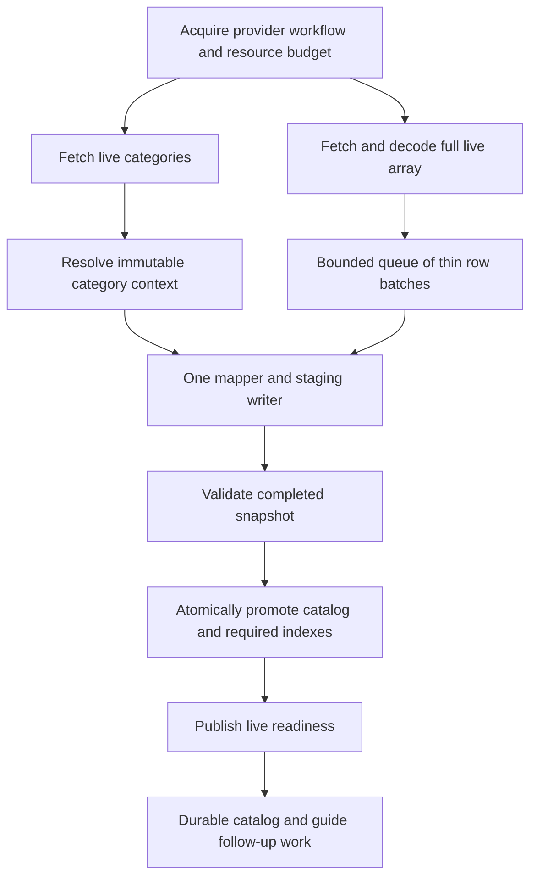

# Xtream sync improvement plan

Status: implementation in progress on `codex/xtream-live-sync-performance`.
Prepared 2026-10-09 against source revision `540ec30c`.

Supporting evidence:

- [Initial live import comparison](XTREAM_LIVE_IMPORT_COMPARISON.md)
- [Current sync engine review](XTREAM_SYNC_PERFORMANCE_REVIEW.md)
- [Initial backend baseline](XTREAM_SYNC_INITIAL_BASELINE.md)
- [Attempt isolation and recovery implementation](XTREAM_SYNC_RECOVERY_IMPLEMENTATION.md)
- [Live parsing and group identity implementation](XTREAM_SYNC_PARSING_IMPLEMENTATION.md)
- [Bounded live pipeline implementation](XTREAM_SYNC_PIPELINE_IMPLEMENTATION.md)
- [Database write and search implementation](XTREAM_SYNC_DATABASE_IMPLEMENTATION.md)
- [Live category scheduling implementation](XTREAM_SYNC_CATEGORY_IMPLEMENTATION.md)
- [Completed primary resume coalescing](XTREAM_SYNC_RESUME_IMPLEMENTATION.md)
- [P6 live strategy and tuning report](XTREAM_SYNC_P6_TUNING_REPORT.md)
- [P7 summary and background implementation](XTREAM_SYNC_P7_IMPLEMENTATION.md)
- [P0 50k scale and batch sweep](XTREAM_SYNC_P0_SCALE_REPORT.md)
- [Failure handling and continuation queues](XTREAM_SYNC_FAILURE_HARDENING.md)

## Current status (2026-10-10)

| Work item | Status | Done | Remaining |
| --- | --- | --- | --- |
| P0 baseline | In progress | Synthetic backend fixture, initial baseline, synthetic first-browsable-row probe, controlled 50k-row scale/batch sweep, repeated/randomized 10k route comparisons across simulated LOW/MID/HIGH policies, field equivalence after both routes, hidden-scope refresh and fallback, and a verified 503 fallback terminal-state/retry-quiescence fix | Other fixture/provider profiles, terminal-state and retry-quiescence behavior for truncated-body and other failure paths, broader refresh cases, attributable allocation/CPU profile, release-build/device comparison and frozen acceptance gates |
| P0 50k scale and batch sweep | Done | Six API 36 emulator batch profiles plus a matched 50k route comparison; 50,000/50,000 rows committed; same fixture hash | Exploratory only; no repeatable batch-size gain; see linked report |
| P0 10k route comparisons | Done | Three alternating-order LOW/100 pairs plus three seeded randomized pairs per simulated LOW/MID/HIGH policy; complete samples and request logs; see the P0 report | One synthetic fixture and emulator only; other provider distributions remain open; this sweep did not change stage-batch defaults |
| P0 persisted row/field equivalence | Done | All 50,000 rows and 200 category records checked after both routes; malformed rows, hidden-category refresh on both routes, and exact fields after HTTP 503/truncated-body category fallback checked; 10k HTTP 503 fallback now settles at Partial without post-fallback bulk retries | Synthetic emulator only; other failure paths and provider distributions remain open; see linked report |
| P1–P5 | Done | Implementation and focused correctness/performance evidence are recorded in the linked reports | P6/P8 release acceptance still depends on these components passing the full matrix |
| Failure handling and continuation queues | Done | Live/VOD authentication termination, durable category-discovery retries, failed-live freshness correction, permanent section queue handling, and 30-second truncated/503 fallback checks | Other fault/provider profiles, longer retry observation and real EPG/playback acceptance remain open; see linked report |
| P6 implementation and emulator exploration | Done | Bulk-first AUTO is active in normal app profiles on this branch; hidden-scope behavior, progress labels, and synthetic 10k-row tuning matrix are implemented | Physical-device/provider acceptance remains open; stage batch defaults are unchanged |
| P6 emulator follow-up | Done | Fresh benchmark APK exercised 10k-channel AUTO bulk success and HTTP 503 category fallback; prior Settings refresh, Welcome-to-Live first-row, and no-ID stale-worker checks also passed on API 36 emulator | Physical LOW/MID/HIGH, real-provider and sustained-playback validation remain deferred |
| P6 physical-device/provider validation | Deferred | No physical devices are available; the branch debug APK is installed and launched for user-side provider testing | Run and record the real-provider sync/playback check; physical LOW/MID/HIGH validation stays deferred |
| P7 implementation | Done | Summary diffing/fingerprints, checkpointed row/time slices, catalog-before-guide scheduling, focused unit coverage, and fingerprint allocation reduction | Bulk-refresh gain is route-specific; physical tuning remains open |
| P7 emulator summary matrix | Done | 2k/1k category fallback under LOW/MID/HIGH/DEVICE; bulk-success comparison; 8k/4k bulk-success and LOW fallback; Room counts and warmup preservation checks passed | Physical tuning is tracked separately |
| P7 before/after unchanged VOD refresh comparison | Done | Pre-P7 commit compared with P7 working tree on the same API 36 emulator, fixture, LOW policy and 100-row stage batch; ten measured bulk-success samples and five fallback samples per build | Bulk success was 59.69% faster; fallback was effectively unchanged; sampled heap increased, so no blanket speedup claim |
| P7 fingerprint allocation follow-up | Done | Removed per-field length-buffer and per-byte formatter allocations while preserving persisted SHA-256 encoding; repeated emulator runs passed for bulk success and category fallback | Sampled refresh peak fell 32.4% on bulk success and 25.5% on fallback versus P7; physical tuning is still required |
| P7 physical-device tuning | Deferred | Not run; no physical devices are available | Resume if target hardware becomes available |
| P8 end-to-end release validation | Pending | — | Real-provider two-channel sustained playback and rollout/rollback evidence |

The reference implementation provides hypotheses to investigate, not a design
authority or proof of correctness. Choose behavior for this app's measured
performance, provider compatibility, persistent library and recovery guarantees.
Keep, change or reject each reference idea independently. No performance claim
from another app substitutes for our validation.

## Outcome and scope

Make the complete Xtream live lineup available substantially sooner when adding
a provider. Apply the same ingestion improvements to Settings Live TV sync and
automatic refresh. Then improve movie/series summary ingestion and background
work using the proven components.

Priority order:

1. Initial Add Provider live import: request topology, parsing, mapping, staging
   and promotion through the first usable live screen.
2. Settings/manual/background live refresh, including unchanged catalogs.
3. Movie/series summaries and index persistence.
4. Background scheduling, EPG handoff and progress clarity.

EPG scheduling does not explain the initial live import delay. Keep it outside
the first performance milestone. Keep movie/series payloads and EPG out of the
initial live bandwidth budget; retain their durable follow-up behavior.

The milestone means the complete accepted live catalog is committed and
browsable. A preview or earlier completion label does not count as faster full
ingestion. Retain Room storage, provider configuration workflows and existing
repository contracts. Other provider protocols receive regression coverage when
shared helpers change; redesigning their ingestion is outside this plan.

## Performance contract

Capture baseline before changing behavior. Record both the entire Add Provider
journey and its live segment: authentication, ingest, promotion and first live
screen. Also report the time from live promotion to setup completion, so category
shell or navigation costs cannot be silently attributed to live ingestion.

Initial engineering targets, to calibrate against baseline measurements:

| Scenario | Target |
| --- | --- |
| Many-category initial import on a healthy bulk-capable provider | At least 80% lower median complete-live time than current AUTO, a 5x improvement; 10x is a stretch target |
| Parsing on identical bulk payload | At least 50% lower parser CPU time without changing accepted row semantics |
| Existing healthy bulk route | Improve the dominant measured costs; no repeatable median or tail regression above 10% |
| Unchanged live refresh | Skip unchanged catalog writes and eliminate unnecessary full index passes |
| Memory | Bounded transient parse/map/write batches, no OOM on agreed LOW/MID/HIGH device scenarios |
| Correctness | Same complete channel coverage and required fields; preserve stable IDs and user state |

These are targets, not established results. Network-limited and bulk-rejecting
providers need separate expectations. Freeze scenario-specific release gates
after baseline; document a revised target if measurements show a different
constraint. Count reduction alone is insufficient to establish a speedup.

Use one warm-up and at least five measured runs for each main baseline/final
comparison, report median and maximum; use a larger sample before claiming p95.
Use the same fixture seed/provider snapshot, device, build type, network policy
and hidden-category settings. Clean provider state for initial-import runs;
preserve state for refresh runs. Separate emulator diagnostics from measurements
on a physical TV-class device. Report setup/account validation latency separately
from catalog speed when the server varies it.

## Architecture decisions

### Bulk first, provider-aware fallback

AUTO should prefer the validated bounded bulk path for a healthy provider.
Device tier controls resource budgets; LOW/MID alone should no longer force
hundreds of requests once the new path passes constrained-device validation.
Explicit CATEGORY_BY_CATEGORY remains a supported choice. Explicit STREAM_ALL
continues to express a bulk preference, with failures surfaced or recovered
according to a documented contract; do not silently label fallback as bulk.

Persist observed bulk support/failure state with a cooldown and eventual probe.
Existing liveAvoidFullUntil and health fields may be reused when their meaning
matches. Do not conflate category throttling with proof that bulk is unsupported.
Separate authentication failures, HTTP throttling, interrupted transfers,
malformed shapes, size admission failures and actual memory pressure.

For hidden categories, support early row filtering plus preservation of existing
hidden content and required hidden rows. Full bulk still downloads hidden rows,
so a provider with most categories hidden may benefit from selected categories.
Use measured/known catalog coverage for that decision; a newly added provider
has no reliable category size estimates. Keep destructive pruning confined to
confirmed complete scopes.

### Two concurrent live requests and a bounded pipeline

After authentication and workflow acquisition, start live category retrieval
and one bulk live-stream request concurrently. The same provider request budget
governs both. Do not split one live array into arbitrary parallel downloads.

The intended AUTO default is one complete live-list HTTP response, decoded
incrementally as it arrives. Parallelism comes from fetching category metadata
alongside it and overlapping decode with mapping/database staging. The current
bulk request interface does not provide independently addressable row ranges;
starting the same full request multiple times repeats data rather than divides
work. Parallel category requests remain the fallback/selected-category strategy.

Do not fetch movies/series in parallel with initial live ingestion by default:
they compete for provider connections, bandwidth, CPU and memory while the
priority is live readiness. Their later concurrency should be measured within
the shared resource budget. Benchmark bounded concurrent category loading as
an alternative to bulk too; if a provider handles categories substantially
better, the provider-aware planner should use that evidence.

The reader produces thin rows. The consumer waits for category context before
classification and staging; the queue may fill while categories are pending,
but stays bounded. Category retrieval returns either authoritative context or
an explicit failure result with existing fallback-category semantics. Resolve
that result once; mapping must not trigger repeated category network fetches.

Use structured coroutines: reader failure cancels/drains the consumer safely;
writer failure cancels the HTTP call; parent cancellation closes response bodies
and queues. Close normally only after valid end-of-document. Promotion waits
for reader completion, queue drain and all durable writes.

One writer owns counters, duplicate admission and session state. This avoids
concurrent mutation and category-stage mutex contention. Bound queued batches,
row field sizes according to existing admission rules, retained metadata and
any producer concurrency. A bounded queue alone does not make an unbounded
HashSet of all stream IDs or category cache bounded: account for these explicitly
and evaluate stage-table uniqueness as an alternative deduplication mechanism.

Initial tuning candidates, evaluated against current 100/300/500 batches:

| Tier | Candidate row batch size | Maximum queued batches |
| --- | --- | --- |
| LOW | 128–256 | 1 |
| MID | 512 | 1–2 |
| HIGH | 1,024 | 2 |

These are benchmark candidates, not production defaults. Count the producer's
current batch and writer's current batch too. Select production values using
allocation/heap headroom, row width, cancellation latency and transaction
duration. Retain global size caps and bounded SQL parameter chunks. Parallel
provider imports need an app-wide resource budget, not only per-provider limits.

### Direct decoding and minimal mapping

Introduce a live-specific direct token decoder, initially alongside the current
path. The existing JsonReader infrastructure can be reused; avoid per-row Gson
trees, JSON reserialization and second decoding. Return thin typed live rows,
not a generic map retaining every scalar field. Skip irrelevant nested payloads.

Support current numeric/string/null field variants, singular/plural category
IDs, archive flags and provider text compatibility. Add deliberately supported
root-array/wrapper shapes with explicit recognition. Authentication/error
objects must never become successful empty catalogs. Distinguish a malformed
row with valid structural boundaries from an invalid/truncated JSON document.
Track skipped rows and prevent degraded coverage from being labeled complete.

Preserve server ordering/num, EPG IDs, catch-up fields, adult/protection behavior,
logo cleanup and internal stream URL semantics. Keep provider credentials out
of logs. Retain custom headers and User-Agent on every request.

Extract a group-key-only path from ChannelNormalizer after proving it produces
the same logicalGroupId as classify. Avoid calculating unused resolution,
language, codec and other variant attributes during import. Keep canonical key
semantics stable, because changing grouping identity can affect the library.
Compute row fingerprints once from normalized fields where practical.

### Attempt isolation and durable snapshot rules

Audit retry/fallback before introducing concurrency. Current full streaming
keeps staging session, seen IDs and counters outside the retry block. New code
must make ownership and reset behavior explicit; this observation is a risk to
test, not a claim of a reproduced data-loss bug.

Each bulk attempt owns a fresh session, counters and buffered batches. On a
failed attempt, cancel/drain work and discard its session before retry. If a
future resumable protocol is implemented, it needs explicit coverage/checkpoint
semantics; concatenating two full responses is not a resume protocol.

For category fallback, isolate category attempts too. Only successful category
attempts contribute confirmed coverage; promote them into the import session
without letting failed retries leave stale membership. Keep successful category
results while retrying failed categories. This requires category-scoped attempt
staging or equivalent provenance, not a shared dedup set alone.

Persist complete-response status separately from staged row count. Recover and
fully promote only a snapshot durably marked complete after writer drain. The
current onboarding recovery must be checked because non-empty staged rows alone
cannot prove the remote response finished. Incomplete bulk sessions restart or
remain explicitly partial; they must never trigger full stale-row deletion.

Retain configuration generation, workflow lease and commit fences in the same
transaction as promotion. Recheck ownership for staging/commit under the existing
contract; optimize query frequency only with equivalent supersession protection.
If extra fields/tables are necessary, include Room migration and older-state
recovery tests. Temporary failures leave the previous active catalog intact.

### Efficient persistence and indexes

Track accepted stage count in the session writer after successful writes;
reconcile from the database when recovering. Enforce limits using admitted
unique rows, and do not count duplicates as additional catalog coverage.
Investigate bounded category SQL summaries instead of repeatedly materializing
all fallback categories each batch. Keep transaction duration controlled.

For first import, use staged bulk insertion and SQL promotion without loading
the entire live lineup into Kotlin. For refresh, use fingerprints/changed-row
diffs to avoid rewriting unchanged channels. Preserve local IDs, favorites,
user protection, overrides and history. Optimize correlated changed-column
lookups only after separating first-import and refresh measurements.

Verify Room FTS maintenance triggers on fresh and upgraded databases. Remove
the global rebuild from routine promotion only if integration tests prove search
correctness for inserts, renames, removals, unchanged refresh and multiple
providers. Retain an explicit repair/rebuild operation. Do not suppress triggers
without a transactionally correct replacement.

Replace the later whole-list Xtream live index backfill with SQL projection or
bounded updates. Decide whether the auxiliary index is required for initial
browsing/search; required indexes complete before their readiness milestone.
Every index must use the same complete generation, including safe stale cleanup.
Do not advertise search readiness while a required index remains queued.

### Category fallback that stays busy

Replace grouped awaitAll windows with a continuously filled bounded worker pool.
Start conservatively and adapt request concurrency and spacing using measured
provider stress. Retain a device/resource ceiling, honor usable Retry-After,
back off on throttle/reset/timeout and stop pointless authentication retries.
Healthy providers should not inherit a universal 250 ms request-start delay.

Use one writer for all successful category producers. Persist category coverage
and retry failed categories only. Avoid sharing unsafe modifications with other
protocols. Keep non-retryable errors, valid emptiness and partial success distinct.
Test the effect of UI priority requests without interrupting a coherent commit.

## Implementation work packages

Each package is a separately reviewable change with its own evidence. Run
focused checks after each; run the complete relevant set at integration/release.
Measurements can change tuning choices, but must not silently change coverage
or completion semantics.

| Package | Work and primary files | Depends on | Exit criteria |
| --- | --- | --- | --- |
| P0 | Baseline and scalable fixture; timing in OkHttpXtreamApiService, live strategy, SyncCatalogStore, setup/readiness; tools and benchmark harness | Inspection | Reproducible initial/refresh report with counts, strategy and stage/memory costs |
| P1 | Attempt isolation, durable completion/coverage, cancellation; live strategy, catalog stager/store, onboarding state/DAO, commit fence | P0 | Truncation/retry/process-death cannot promote an incomplete full snapshot or lose active data |
| P2 | Direct live token decoder and compatible thin rows; HTTP service, XtreamDtos, XtreamProvider, ChannelNormalizer | P1 | Field-equivalent output, correct errors and lower measured parse/map CPU |
| P3 | Concurrent category/bulk retrieval and bounded reader/writer pipeline; live strategy/support, stager, runtime profile | P2 | Observable overlap, enforced queue/resource bounds, no extra category fetches, complete cancellation |
| P4 | Stage accounting, promotion/FTS/index cost; catalog store/DAO, index DAO, live backfill | P3 | Lower stage/commit cost, unchanged rows avoided, verified search and stable user state |
| P5 | Refilled category workers and adaptive pacing; XtreamFetcher, XtreamSupport, adaptive policy | P1 and P3 | Idle slots reused; isolated failed categories; reliable throttled/bulk-rejecting fallback |
| P6 | AUTO strategy and unified live behavior; live policy/profile, metadata, full/section routing, setup and Settings progress | P4 and P5 | Bulk default passes LOW/MID/HIGH scenarios; explicit modes and hidden scopes work across entry points |
| P7 | Movie/series summaries reuse and background priority; incremental executor, worker, continuation scheduler, summary DB writes | P6 | Faster summaries, preserved hydrated details, catalog-before-guide scheduling, bounded completion jobs |
| P8 | End-to-end acceptance, sustained playback, rollout and report | P6; P7 for full Xtream release | Gates met, evidence archived, rollback path proven |

P6 is the first live performance release milestone; P7 follows it. Normal app
builds on this branch now use bulk-first AUTO so the changed sync can be tested
directly. Keep the measured stage-batch defaults until physical-device evidence
supports a retune. The isolated benchmark package can still compare the prior
AUTO policy with the bulk-first policy using identical data coverage.

Implementation progress on 2026-10-10: P0 has an initial backend baseline,
isolated fixture, synthetic first-browsable-row probe, controlled 50k-row
scale/batch sweep, matched bulk/category comparison, all-row field equivalence
for both initial-import routes, malformed-row handling, a hidden-scope live
refresh check on both routes, 503 and truncated-body category fallback field
checks, and repeated/randomized 10k route comparisons across simulated
LOW/MID/HIGH policies. Larger batch profiles did not show a repeatable
elapsed-time gain, so production batch defaults remain unchanged. The original
503 run exposed `Syncing` plus three later bulk retries after full category
coverage. After updating queued onboarding recovery coalescing, a repeat 10k
HTTP 503 run verified 10,000 fields and 100 categories, settled at `Partial`,
made only the three initial bulk attempts and zero post-fallback bulk requests;
the log confirmed the queued recovery was coalesced after onboarding completed.
The truncated-body run showed `Partial` after full row coverage but has not been
rerun after this change. Other fixture/provider comparisons, lifecycle checks
for other failure paths, broader refresh cases, attributable allocation/CPU
profiling, release-build/device comparison and frozen acceptance gates remain
open; see the
[P0 scale report](XTREAM_SYNC_P0_SCALE_REPORT.md). P1 attempt isolation and conservative receipt-based
recovery are implemented and validated. P2 direct live decoding and cheaper
group identity are implemented with field-equivalence checks and measured
component CPU reductions. P3 retrieval overlap and a bounded reader/writer
pipeline are implemented with cancellation, resource-bound and real-graph
setup/refresh evidence. P4 stage accounting, fingerprint costs, SQL live-index
projection and trigger-maintained search are implemented with fresh/migrated
Room checks and measured backend improvements. P5 refilled live-category
workers and adaptive pacing are implemented with cancellation, authentication
and Retry-After coverage. Targeted primary recovery now rechecks completion
under the provider lock and coalesces already successful foreground imports.

Bulk loading progress follow-up (2026-10-10): the Add Provider callback now
reports the accepted channel count after successful staging writes, for example
`Loading Live TV channels...` followed by `3,200 channels processed`. Updates
are throttled to 250 ms, with the final drained count always published. A new
attempt clears the discarded count. The bar remains indeterminate because
the bulk endpoint supplies no reliable total; Saving and Ready remain tied to
catalog promotion. Focused reporter, strategy callback and progress-parser
tests cover these behaviors; no real-provider UI acceptance is claimed here.

P6 bulk-first AUTO behavior, hidden-category routing and user-facing progress
are implemented. Normal app profiles now enable bulk-first AUTO; the isolated
benchmark package retains an explicit policy override for comparisons. Batch
and policy measurements cover one synthetic API 36 emulator, 10,000 rows and
five measured runs, but tier values were simulated. A fresh build was reinstalled
and rerun on the emulator: AUTO retained and field-verified all 10,000 channels
with one bulk request; a second AUTO run with three HTTP 503 bulk rejections
completed all 100 category requests, retained and field-verified all 10,000
channels, and emitted no post-fallback bulk retries. The synthetic setup-to-first-row
measurement exercises the real Welcome-to-Live UI with a synthetic channel, and the no-ID
ProviderSyncWorker stale-refresh branch succeeds through WorkManager with
preserved 10k catalog coverage. These are emulator evidence, not physical-device
or release-build comparisons; WorkManager interval/constraint scheduling,
real-provider behavior and sustained playback remain open. The P6 release gate
therefore remains open even though bulk-first AUTO is now active on this branch.
Production stage-batch defaults remain unchanged. P7 summary deduplication,
bounded category slices,
catalog-before-guide scheduling and separate guide work are implemented with
focused tests. The API 36 emulator completed the synthetic VOD/series matrix:
2k/1k category fallback under LOW/MID/HIGH/DEVICE, a bulk-success comparison,
and 8k/4k bulk-success and LOW fallback runs. Counts, index jobs, and warmup
Room preservation checks passed. A separate unchanged-summary refresh
comparison against pre-P7 commit
`2af03f5149e888d25307457d4cce82fab3de74d9` used ten measured bulk-success
samples and five fallback samples per build. Median time was 59.69% lower on
the bulk-success route, while category fallback was effectively unchanged
(0.89% lower). Maximum sampled Java heap rose from 10.09 to 17.19 MiB on bulk
success and from 9.01 to 10.83 MiB on fallback. The full bulk sample set is
reported because baseline timings settled during measurement; no samples were
trimmed. The result supports only a bulk-success refresh gain; fallback and
memory observations remain open for physical-device tuning. A follow-up removed
per-field length-buffer and per-byte formatter allocations while retaining the
same fingerprint encoding. Repeated unchanged-refresh runs reduced the sampled
peak by 32.4% on bulk success and 25.5% on category fallback versus P7; fallback
timing remained effectively unchanged. The bulk peak remains 1.52 MiB above
the pre-P7 maximum, and all results are from one emulator. Physical tuning is
deferred because no physical devices are available. P8 is pending because
real-provider sustained playback and rollout/rollback validation have not been
performed. The status table above marks completed work separately from open
acceptance. Reports linked above record the evidence and limits.

## P0 measurement and fixture deliverables

Add a dedicated configurable Xtream performance fixture; do not inflate the
existing one-channel catalog correctness fixture or change its stable entries.
Suggested artifacts: tools/xtream_sync_perf_fixture.py, fixture tests, and a
connected benchmark driver writing ignored build/xtream-sync-performance files.
Keep payload generation streaming too, so fixture memory/server generation does
not dominate or mimic client performance. Record server request starts/ends,
bytes and fixture seed. Use synthetic credentials only.

Provide configurable channel/category counts, deterministic metadata, category
distribution, bandwidth/header delay, category latency, throttling, bulk rejection,
malformed rows and mid-response disconnects. Record the dataset checksum.

Timing records use a monotonic clock, run ID, provider ID, configuration
generation, section, attempt and strategy. Include:

- Authentication, workflow wait and request start/header/first-row timestamps.
- Categories ready, reader complete, writer drained, commit complete, setup
  complete and first browsable live-screen timestamps.
- Accepted/duplicate/skipped/hidden counts, confirmed category coverage, bytes,
  requests, retries/fallback reasons and maximum active request count.
- Parse/map/stage CPU or attributable duration, queue blocked time/high-water,
  transaction/FTS/auxiliary-index durations, peak heap and GC activity.

Overlapping stage durations cannot be summed to derive wall time. Reader
completion includes backpressure; distinguish it from parser CPU and network
waiting. Avoid claiming pure transfer time from the current full ingest timer.
Log aggregate/batch summaries with throttling, never per channel. Export
sanitized JSON and a compact Markdown comparison; no credential URLs or body
previews in benchmark artifacts.

## P6 behavior across entry points

Add Provider uses the new pipeline and finishes after a coherent live catalog
and existing required setup work. Publish live readiness immediately at the
proper milestone; movie/series summaries and EPG remain durable follow-ups.
Preserve provider activation and saved-with-warning behavior for empty or
unavailable live-only/VOD-only providers. Navigation must not depend on an
auxiliary background job that the live screen does not require.

Settings TV, full refresh and background stale refresh share the same live
planner and importer. Reason affects priority/refresh policy, rather than forcing
category loading for every manual/background request. Explicitly map full and
section requests so FOREGROUND does not hide a manual/background reason.
Respect force versus freshness and cancellation. Unchanged refresh should keep
the current catalog visible throughout.

Progress phases: connecting, loading live channels, saving channels, live ready.
Use item counts when the provider has no trustworthy total; do not manufacture
a percentage. Category fallback may show confirmed categories/total. Progress
and completion must represent committed rows, not only decoded or queued rows.
Expose strategy/fallback details in diagnostics, with plain user-facing labels.

## P7 remaining Xtream work

Reuse direct-decoding and bounded-write components for movie/series summary
streams after their live validation. Keep rich details and episodes on demand.
Preserve existing hydrated fields, TMDB identities and watch progress during
summary refresh. Skip unchanged rows, avoid read-after-write where stable ID
mapping can be obtained cheaply, and maintain required indexes in bounded work.

Replace the universal two-category worker slice with a measured time/row budget
and durable per-category checkpoints. Guarantee forward progress under repeated
failures and requested-category priority. Prune stale items only after confirmed
complete section coverage, preserving hidden scopes and partial results.

Schedule required catalog work ahead of delayed guide work in the existing
provider workflow chain. Coalesce redundant pending work where possible. Do not
create competing queues without addressing leases, locks and commit ownership.
Guide retry/delay should not starve movie/series availability. Settings must
distinguish category shells queued, summary catalog complete and guide complete.

## Validation matrix

| Area | Required scenarios and assertions |
| --- | --- |
| Dataset | Small 1k, typical 10k, large 50k/100k live rows within existing admission limits; 1/20/200/500 categories; uneven and empty categories; duplicate IDs |
| Provider | Healthy bulk, slow headers/body, category-only, throttle with/without Retry-After, resets, authentication/error-object response, unsupported wrapper, oversized response |
| Parser | String/number/null IDs and flags, category_ids, order/num, EPG IDs, catch-up, Unicode/text compatibility, unknown/nested fields, valid empty, semantic bad row, truncated JSON after staged batches |
| Refresh | Zero/1%/30% changed rows, additions/removals/renames, multiple providers, hidden/protected/required categories, existing favorites and local overrides |
| Lifecycle | Cancel during categories/reader/write/commit, writer failure, process death before/after completion receipt, retry after partial body, provider edit/delete/supersession, app restart |
| Memory/concurrency | LOW/MID/HIGH, actual pressure, long/wide rows, full queue, slow writer, duplicate tracker growth, simultaneous provider work, cancellation while backpressured |
| Entry points | Add Provider, Settings TV, full refresh/rebuild, automatic refresh, explicit AUTO/STREAM_ALL/CATEGORY_BY_CATEGORY, live-empty provider with other content |
| Search/index | Insert/update/delete/unchanged results, old DB migration, global multiple-provider FTS correctness, incomplete/complete auxiliary index states |

Extend existing focused tests: OkHttpXtreamApiServiceTest, XtreamDtoParsingTest,
XtreamProviderTest, SyncManagerXtreamLiveStrategyTest, SyncManagerXtreamSupportTest,
XtreamLiveSyncPolicyTest, SyncCatalogStoreTest, commit-fence/workflow tests and
ChannelNormalizer tests. Add genuine backpressure/cancellation/attempt isolation
tests with controllable producer/writer barriers. Do not use timing sleeps as
the primary unit-test assertion for concurrency.

Use Room instrumentation for actual FTS trigger/migration/promotion behavior,
stable IDs and process-death recovery, extending CatalogSyncEquivalenceIntegrationTest
and ProviderWorkflowIntegrationTest where appropriate. Extend setup/Settings
tests for actual completion/warning/cancel semantics. Benchmark generated Room
code on-device; mocked DAO timings are not persistence performance evidence.

Run focused data/domain/feature Gradle test tasks as affected, followed by data
connected instrumentation and the app/benchmark journey for the changed routes.
Resolve exact test variants from the project at implementation time. No build,
launch or single screenshot is sufficient evidence of an improved sync.

After the final live change, select at least two representative live channels
and validate actual playback in the emulator using repository instructions:
61 screenshots per channel at 2-second intervals, unique hashes demonstrating
continued progression, media-session PLAYING with error=null, and sanitized
HLS/recovery logs with no fatal/stuck error or unintended MPEG-TS fallback.
Report channel names, count/interval, unique hashes, media session and log findings.
This verifies playable imported rows; fixture-only channel counts cannot replace
it. Retain screenshot sequences and logs under ignored validation artifacts.

## Rollout, rollback and completion

Keep implementation changes separable from strategy selection. Use internal
debug configuration for controlled comparisons; avoid exposing experimental
parser/batch toggles to users. Ship the validated live path before expanding
to other sections. Preserve explicit category mode as a compatibility escape
route; actual rollback can revert AUTO selection independently of the parser.
Prove migrations and session receipts remain readable by the supported rollback
version, or document a version boundary before shipping schema changes.

Completion checklist:

- [ ] P0 baseline archived, bottleneck ranking and gates frozen.
- [ ] P1–P5 correctness and performance evidence reviewed.
- [ ] P6 live-only release meets agreed latency/memory/coverage gates.
- [ ] Settings/background refresh passes the shared-path matrix.
- [ ] Required browse/search indexes and user state remain correct.
- [ ] Retry/cancel/death/edit/delete preserve coherent catalog ownership.
- [ ] Two-channel sustained playback report recorded.
- [x] P7 catalog/guide follow-up improvements verified independently.
- [x] Before/after report includes build revisions, device/runtime, data seed,
  counts, requests, medians/spread, heap/GC, fallback behavior and limitations.
- [x] Branch AUTO activation/default behavior, direct-test APK and current
  validation limits documented.
- [ ] Release rollout/rollback and supported schema migration compatibility
  proven.

No package is marked complete until its evidence exists. The first P0 backend
harness, timing hooks and measurements are implemented on
`codex/xtream-live-sync-performance`. See the
[benchmark guide](XTREAM_SYNC_BENCHMARK.md) and
[initial baseline](XTREAM_SYNC_INITIAL_BASELINE.md) for the initial redirected
category-only runs and remaining P0 gates. Later P6 candidate runs exercised
the synthetic bulk route; they do not replace physical-device, provider, or
first-screen measurements. Follow-up work also showed requests continuing
after workflow supersession; prompt termination and joined cleanup are covered
by P1. Measured bottlenecks guide tuning while the correctness and complete-live
outcome above remain fixed.
